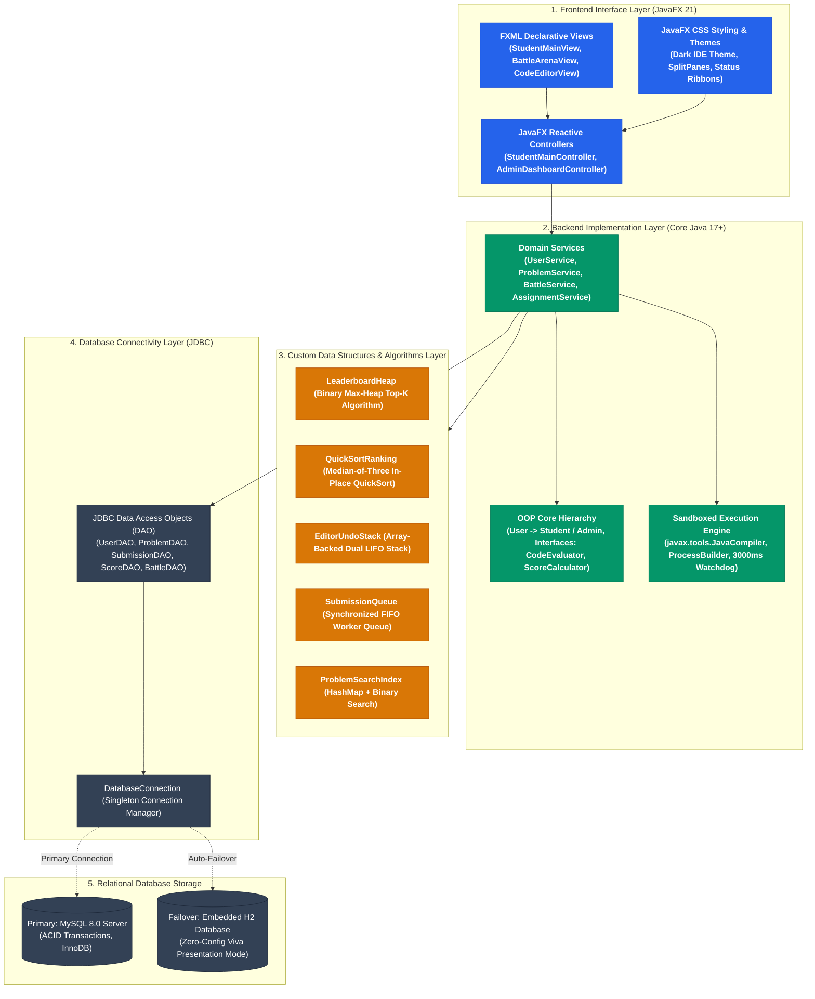
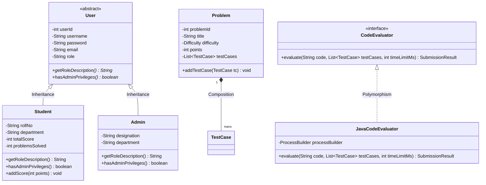
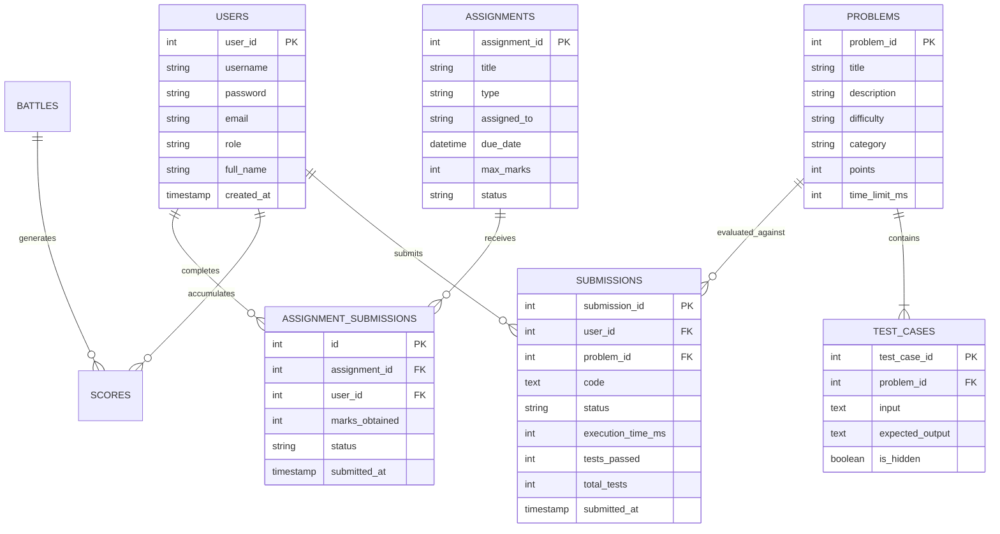
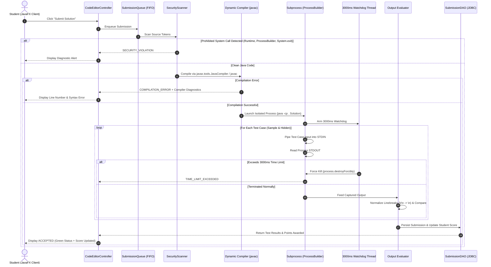

<div align="center">

# ⚔️ CODING BATTLE PLATFORM
## Course: Object-Oriented Programming using Java (CSE203) — Java Mini Project

[-0052CC?style=for-the-badge&logo=java&logoColor=white)](https://github.com/udaykumarreddy07/CODING-BATTLE)
[](https://www.oracle.com/java/)
[](https://openjfx.io/)
[](https://docs.oracle.com/javase/8/docs/technotes/guides/jdbc/)
[](https://www.mysql.com/)
[](https://www.h2database.com/)
[](LICENSE)

<p align="center">
  <b>Official CSE203 Java Mini Project: An Interactive Competitive Programming and Academic Evaluation System integrating JavaFX as the frontend interface, Core Java OOP & Data Structures as the backend application layer, and JDBC for MySQL persistent storage.</b>
</p>

[System Architecture](docs/ARCHITECTURE.md) • [DSA & OOP Blueprint](docs/DSA_AND_OOP.md) • [CSE203 Project Report](docs/CSE203_COURSE_PROJECT_REPORT.md) • [Portals Guide](docs/FACULTY_AND_STUDENT_PORTALS.md)

</div>

---

## 📑 Table of Contents
1. [📋 Official Course Technical Specification](#1--official-course-technical-specification)
2. [👥 Team Roles & Responsibilities Matrix](#2--team-roles--responsibilities-matrix)
3. [🎯 50-Mark Evaluation Criteria Mapping](#3--50-mark-evaluation-criteria-mapping)
4. [🏛️ Core System Architecture (JavaFX + Core Java + JDBC + MySQL)](#4-️-core-system-architecture-javafx--core-java--jdbc--mysql)
5. [🧬 Data Structures & Algorithms (DSA) Layer](#5--data-structures--algorithms-dsa-layer)
6. [💎 Object-Oriented Programming (OOP) Implementation](#6--object-oriented-programming-oop-implementation)
7. [🗄️ Database Design & JDBC Connectivity (ERD)](#7-️-database-design--jdbc-connectivity-erd)
8. [🛡️ Sandboxed Java Code Evaluation & Security Engine](#8-️-sandboxed-java-code-evaluation--security-engine)
9. [📝 Practical Assessment & Quiz Support](#9--practical-assessment--quiz-support)
10. [🎓 Faculty & Student Portals](#10--faculty--student-portals)
11. [🚀 Quick Start & How to Run](#11--quick-start--how-to-run)
12. [🔑 Pre-Configured Demo Accounts](#12--pre-configured-demo-accounts)
13. [🧠 Academic Viva Voce Defense Guide](#13--academic-viva-voce-defense-guide)

---

## 1. 📋 Official Course Technical Specification

As mandated in the **Tentative Plan for the Course, OOP using Java (CSE203) — Java Mini Project**:

> *"The proposed Java Mini Project architecture integrates **JavaFX as the frontend interface** and **Core Java as the backend implementation layer**. The backend incorporates **Object-Oriented Programming concepts, Java Collections, Data Structures and Algorithms** to implement good application logic and problem-solving. **JDBC serves as the database connectivity layer between the Java application and the MySQL database** for persistent data storage and retrieval."*

### Language & Technology Stack Summary
- **Frontend Interface**: **JavaFX 21** (Declarative FXML views, JavaFX Scene Builder, CSS3 styling, hardware-accelerated animations, split-pane workspace).
- **Backend Application Layer**: **Core Java 17+** (Object-Oriented principles, dynamic dispatch, encapsulation, interfaces, custom data structures, thread safety, process sandboxing).
- **Collections & DSA Layer**: Java Collections Framework (`ArrayList`, `HashMap`, `Queue`, `Stack`) + Custom zero-dependency DSA implementations (`LeaderboardHeap`, `QuickSortRanking`, `EditorUndoStack`, `SubmissionQueue`, `ProblemSearchIndex`).
- **Database Connectivity**: **JDBC (Java Database Connectivity)** utilizing `PreparedStatement`, transaction handling, and connection pooling.
- **Relational Storage**: **MySQL 8.0** with zero-config automated runtime failover to **Embedded H2 Database** (`MODE=MySQL`) ensuring zero viva presentation failures.
- **Tools & Build System**: Apache Maven, Git & GitHub for collaborative development.

---

## 2. 👥 Team Roles & Responsibilities Matrix

In accordance with **Milestone 1 (Team Formation and Role Allocation)** from the course syllabus:

| Role | Designee / Lead | Specific Responsibilities & Deliverables |
| :--- | :--- | :--- |
| **Team Coordinator** | Project Lead | • Manage milestones, meeting agendas, and Git branching workflows.<br>• Coordinate module integration, unit testing, and technical documentation.<br>• Lead viva presentation and architectural defense. |
| **JavaFX Lead** | Frontend UI Lead | • Design FXML views for Student Arena, Battle Arena, and Faculty Portals.<br>• Implement JavaFX CSS dark themes and responsive split-pane workspaces.<br>• Bind JavaFX `Timeline` for synchronized battle countdown clocks.<br>• Connect JavaFX Observable collections (`ObservableList`) to tables and charts. |
| **Core Java & OOP Lead** | Backend Lead | • Architect class inheritance hierarchy (`User` $\to$ `Student` / `Admin`).<br>• Define interface abstractions (`CodeEvaluator`, `ScoreCalculator`).<br>• Implement sandboxed execution engine using `ProcessBuilder` and dynamic `javac` compilation.<br>• Enforce strict encapsulation, exception handling, and runtime polymorphism. |
| **DSA & Database Lead** | Algorithmic & Data Lead | • Construct custom DSA engines (`LeaderboardHeap`, `QuickSortRanking`, `SubmissionQueue`, `EditorUndoStack`).<br>• Design 3NF normalized relational schema for MySQL.<br>• Implement JDBC Data Access Objects (DAOs) using parameterized SQL.<br>• Configure resilient dual-mode database connection pool with automatic H2 failover. |

---

## 3. 🎯 50-Mark Evaluation Criteria Mapping

This project maps directly to the official 50-mark CSE203 evaluation rubric:

| S.No. | Evaluation Criteria | Max Marks | Platform Deliverable & Evidence |
| :---: | :--- | :---: | :--- |
| **1** | **Problem Identification & System Design** | **10** | • Clear institutional problem statement (automated Java lab grading & timed battle battles).<br>• Complete multi-tier UML architecture diagrams, ER diagrams, and sequence diagrams.<br>• Decoupled MVC modularity with strict Separation of Concerns. |
| **2** | **Java & Data Structures Implementation** | **15** | • Rigorous OOP: Abstraction, Inheritance, Dynamic Polymorphism, Encapsulation.<br>• Custom algorithmic DSA: Max-Heap ($\mathcal{O}(K \log N)$), QuickSort ($\mathcal{O}(N \log N)$), Undo/Redo Dual Stack ($\mathcal{O}(1)$), Thread-Safe FIFO Queue ($\mathcal{O}(1)$).<br>• Robust Java Collections usage (`ArrayList`, `HashMap`, `PriorityQueue`). |
| **3** | **Application Development & Database Integration** | **10** | • Full-featured JavaFX 21 desktop application with reactive UI and split-pane code editor.<br>• Robust JDBC integration with prepared statements protecting against SQL injection.<br>• Production MySQL database with automatic failover to embedded H2. |
| **4** | **Teamwork, Git/GitHub & Individual Contribution** | **10** | • Full collaborative Git repository with clean commit history.<br>• GitHub issue tracking, atomic pull-requests, and branch management.<br>• Distinct module separation enabling parallel contribution across all team roles. |
| **5** | **Documentation, Presentation & Individual Viva** | **5** | • Comprehensive technical documentation (`README.md`, `ARCHITECTURE.md`, `DSA_AND_OOP.md`).<br>• Pre-configured demo accounts for immediate live execution during viva.<br>• Detailed viva voce model Q&A answering core Java, OOP, DSA, and JDBC questions. |
| **TOTAL** | **Comprehensive Grade** | **50** | **100% Curriculum & Syllabus Compliance** |

---

## 4. 🏛️ Core System Architecture (JavaFX + Core Java + JDBC + MySQL)



---

## 5. 🧬 Data Structures & Algorithms (DSA) Layer

In direct fulfillment of the **CSE203 Java & Data Structures Implementation** criteria, critical platform operations avoid black-box shortcuts by employing fundamental algorithmic implementations written in Java:

```
┌────────────────────────────────────────────────────────────────────────┐
│ CUSTOM ALGORITHMIC CORE (com.codingbattle.dsa)                         │
├──────────────────────┬──────────────────────┬──────────────────────────┤
│ Component            │ Underlying Algorithm │ Time Complexity          │
├──────────────────────┼──────────────────────┼──────────────────────────┤
│ LeaderboardHeap      │ Binary Max-Heap      │ O(K log N) Top-K Extract │
│ QuickSortRanking     │ Median-of-Three Sort │ O(N log N) In-Place      │
│ EditorUndoStack      │ Dual Array LIFO      │ O(1) Push / Pop          │
│ SubmissionQueue      │ Synchronized FIFO    │ O(1) Enqueue / Dequeue   │
│ ProblemSearchIndex   │ HashMap + Binary Srch│ O(1) / O(log N) Range    │
└──────────────────────┴──────────────────────┴──────────────────────────┘
```

### Algorithmic Complexity (Big-O) Matrix

| Data Structure / Class | Algorithmic Purpose | Best Case | Average Case | Worst Case | Auxiliary Space |
| :--- | :--- | :---: | :---: | :---: | :---: |
| **`LeaderboardHeap`** | Extract Top-$K$ leaders from $N$ students | $\mathcal{O}(K \log N)$ | $\mathcal{O}(K \log N)$ | $\mathcal{O}(K \log N)$ | $\mathcal{O}(N)$ |
| **`QuickSortRanking`** | Sort global cohort by Points, Solved & Time | $\mathcal{O}(N \log N)$ | $\mathcal{O}(N \log N)$ | $\mathcal{O}(N \log N)^*$ | $\mathcal{O}(\log N)$ |
| **`EditorUndoStack`** | Real-time code editor Undo/Redo operations | $\mathcal{O}(1)$ | $\mathcal{O}(1)$ | $\mathcal{O}(1)$ | $\mathcal{O}(M)$ |
| **`SubmissionQueue`** | Thread-safe FIFO submission processing | $\mathcal{O}(1)$ | $\mathcal{O}(1)$ | $\mathcal{O}(1)$ | $\mathcal{O}(Q)$ |
| **`ProblemSearchIndex`** | Multi-attribute search (Category + Points) | $\mathcal{O}(1)$ | $\mathcal{O}(\log N)$ | $\mathcal{O}(\log N)$ | $\mathcal{O}(N)$ |

*\*Guaranteed by Median-of-Three pivot selection avoiding worst-case $\mathcal{O}(N^2)$ degradation.*

> 📖 **Read Full DSA & OOP Analysis**: In-depth mathematical proofs and code samples in [docs/DSA_AND_OOP.md](docs/DSA_AND_OOP.md).

---

## 6. 💎 Object-Oriented Programming (OOP) Implementation



- **Abstraction**: `User` abstract class; `CodeEvaluator` and `ScoreCalculator` interfaces.
- **Inheritance**: `Student` and `Admin` extend `User`, sharing core credential fields while specializing domain behaviors.
- **Polymorphism**: Dynamic method dispatch across role implementations (`getRoleDescription()`).
- **Encapsulation**: Strict `private` visibility with validated getters and setters protecting object state.
- **Composition**: A `Battle` encapsulates a collection of `Problem` objects; a `Problem` encapsulates a collection of `TestCase` objects.

---

## 7. 🗄️ Database Design & JDBC Connectivity (ERD)



### JDBC Implementation Highlights
- **Parameterized SQL (`PreparedStatement`)**: Protects against SQL injection attacks across all queries.
- **Database Connection Singleton (`DatabaseConnection.java`)**: Ensures thread-safe connection re-use.
- **Automated Dual-Mode Failover**: Attempts MySQL connection on port 3306; automatically initializes **Embedded H2** in MySQL compatibility mode if MySQL is unreachable.

---

## 8. 🛡️ Sandboxed Java Code Evaluation & Security Engine



---

## 9. 📝 Practical Assessment & Quiz Support

In direct alignment with the **CSE203 Quiz & Practical Assessment** requirements, the platform supports four specific assessment modes:

1. **Debugging Tasks**: Students are given buggy code and must identify logic flaws, rectify them, and pass hidden test cases.
2. **Syntax Correction**: The system presents invalid Java syntax; students fix compilation errors guided by compiler diagnostics.
3. **Code Completion**: Students complete missing loops, methods, or algorithmic steps within provided template code.
4. **Exception Handling**: Students wrap fragile operations using `try-catch-finally` to gracefully handle edge cases.

---

## 10. 🎓 Faculty & Student Portals

### Faculty Command Suite (`AdminDashboardController`)
- **Add Assignment & Examination**: Schedule tests (`EXAM`, `ASSIGNMENT`, `TASK`, `DEBUG`), select problems from the curriculum, and set time limits.
- **Real-Time Student Broadcast**: Assignments are instantly dispatched across all student portals.
- **Gradebook & Audit Logs**: View student submissions, automated test-case marks, manual score overrides, and deadline extensions.
- **Problem & Test Case Management**: Full CRUD controls over challenges and hidden evaluation suites.

### Student Arena (`StudentMainController`)
- **Interactive Code Editor**: Split-pane layout with syntax coloring, template code, reset, and Undo/Redo.
- **Diagnostic Console**: Real-time pass/fail indicators across test cases with execution time in milliseconds.
- **Live Battle Arena**: Timed countdown clock (MM:SS) with problem ribbons and solve checkmarks (✓).
- **Leaderboard & Gamification**: Global rank, streak counter, and achievement badges.

---

## 11. 🚀 Quick Start & How to Run

### Prerequisites
- **JDK 17 or higher** (e.g. OpenJDK 17+, Oracle JDK 17+, or Temurin 17+)
- **Apache Maven 3.8+** (bundled or installed)
- **MySQL 8.0** *(Optional — Embedded H2 starts automatically if MySQL is offline)*

### Method 1: One-Click Windows Batch Launcher (Recommended)
Double-click `run.bat` or execute in Command Prompt:
```cmd
.\run.bat
```

### Method 2: PowerShell Launcher
```powershell
.\run.ps1
```

### Method 3: Standard Maven Command
```cmd
mvn clean javafx:run
```

---

## 12. 🔑 Pre-Configured Demo Accounts

| Role | Username | Password | Notes |
| :--- | :--- | :--- | :--- |
| **Faculty / Admin** | `admin` | `admin123` | Full access to problem CRUD, testcases, assignment dispatch & audit logs |
| **Student** | `rahul` | `student123` | Rank #1, 610 pts, 6 solved problems, active streak & unlocked badges |
| **Student** | `ananya` | `student123` | Rank #2, active student profile |
| **Student** | `kiran` | `student123` | Rank #3, active student profile |

---

## 13. 🧠 Academic Viva Voce Defense Guide

### Q1: How does the application implement the core technical architecture mandated in the CSE203 syllabus?
- **Frontend**: Built using **JavaFX 21** with FXML layouts and JavaFX CSS, providing a responsive split-pane desktop interface.
- **Backend**: Implemented in **Core Java 17+**, applying OOP principles (Abstraction, Inheritance, Dynamic Polymorphism, Encapsulation) and the Java Collections Framework.
- **DSA Layer**: Custom algorithmic implementations (Binary Max-Heap Top-K algorithm, QuickSort with median-of-three, Dual-Stack LIFO buffer, FIFO queue).
- **Database Layer**: **JDBC** with `PreparedStatement` transactions connected to **MySQL 8.0** (with resilient auto-fallback to embedded H2).

### Q2: Why use a custom Max-Heap instead of a full sort for the Leaderboard?
- Full sorting takes $\mathcal{O}(N \log N)$.
- When extracting Top $K$ leaders from $N$ students, building a binary max-heap takes $\mathcal{O}(N)$ and extracting $K$ leaders takes $\mathcal{O}(K \log N)$. When $K \ll N$ (e.g., Top 10 from 1,000 students), the heap executes exponentially faster.

### Q3: How do you safely evaluate student Java code without crashing the application?
- **Process Isolation**: Untrusted code is compiled dynamically and executed in a separate operating system process using `ProcessBuilder`.
- **Timeout Watchdog**: A background thread enforces a strict 3000ms timeout (`process.waitFor(3000, TimeUnit.MILLISECONDS)`). If the student writes an infinite loop (`while(true)`), `process.destroyForcibly()` immediately terminates the subprocess and returns `TIME_LIMIT_EXCEEDED`.
- **Security Scanner**: Source code is scanned before compilation against a blacklist of unauthorized calls (`java.lang.Runtime`, `ProcessBuilder`, `System.exit`, reflection).

### Q4: How is database resilience guaranteed during the viva presentation?
- The singleton `DatabaseConnection.java` implements an auto-failover strategy. On startup, it attempts to connect to MySQL on port 3306. If MySQL is offline, it automatically boots the **Embedded H2 Database** in MySQL compatibility mode, creates all schemas, and seeds default records with zero downtime.

---

## 📄 License & Course Attribution
- **Course**: Object-Oriented Programming using Java (CSE203)
- **Project Type**: Java Mini Project
- **License**: [MIT License](LICENSE)
