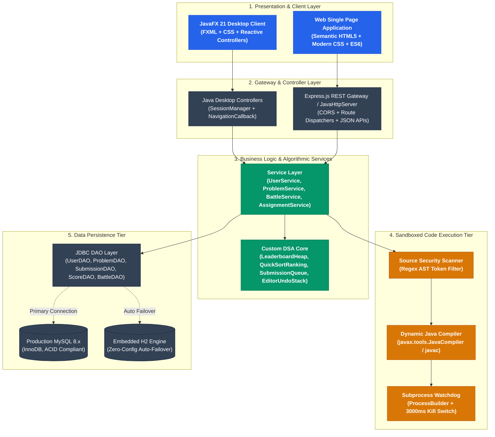
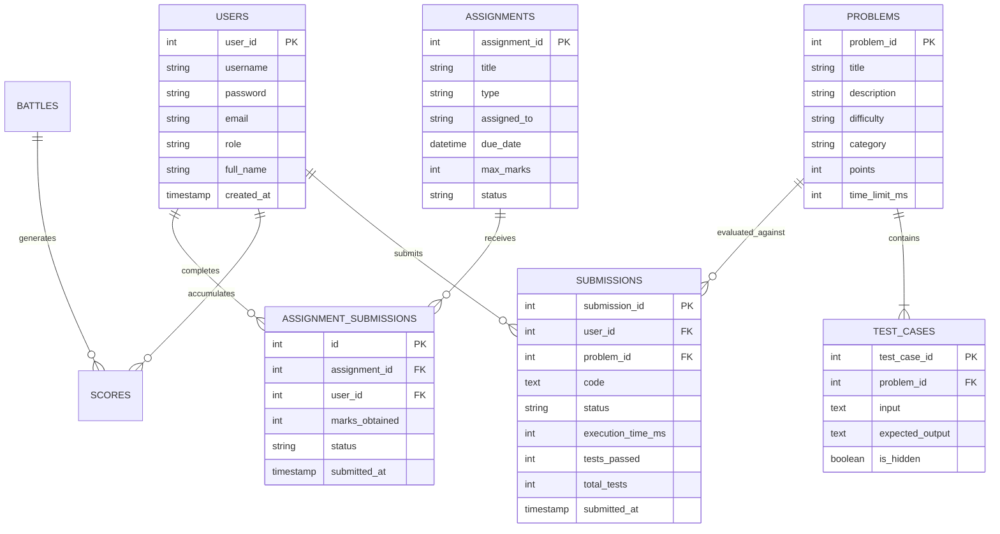
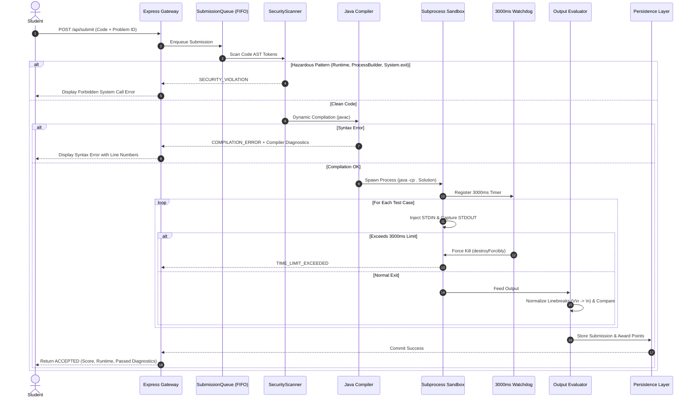

<div align="center">

# ⚔️ CODING BATTLE PLATFORM
### High-Performance Competitive Java Programming, Timed Battles & Academic Faculty Command System

[](https://www.oracle.com/java/)
[](https://openjfx.io/)
[](https://nodejs.org/)
[](https://expressjs.com/)
[](https://www.mysql.com/)
[](https://www.h2database.com/)
[](https://opensource.org/licenses/MIT)
[]()

<p align="center">
  <b>A dual-platform competitive coding ecosystem featuring process-isolated Java code execution, algorithmic ranking engines, synchronized battle countdowns, and a complete Faculty Command Suite for assignment dispatch and real-time student broadcasting.</b>
</p>

[Explore System Architecture](docs/ARCHITECTURE.md) • [DSA & OOP Foundations](docs/DSA_AND_OOP.md) • [REST API Reference](docs/API_REFERENCE.md) • [Portals Guide](docs/FACULTY_AND_STUDENT_PORTALS.md)

</div>

---

## 📑 Table of Contents
1. [🌟 Key Features](#-key-features)
2. [🏛️ System Architecture](#️-system-architecture)
3. [🧬 Data Structures & Algorithms (DSA)](#-data-structures--algorithms-dsa)
4. [💎 Object-Oriented Programming (OOP) Blueprint](#-object-oriented-programming-oop-blueprint)
5. [🗄️ Relational Database & Entity Relationship (ERD)](#️-relational-database--entity-relationship-erd)
6. [🛡️ Sandboxed Java Code Execution Engine](#️-sandboxed-java-code-execution-engine)
7. [🎓 Faculty Command Suite & Assignment Dispatch](#-faculty-command-suite--assignment-dispatch)
8. [🚀 Quick Start & How to Run](#-quick-start--how-to-run)
9. [🔑 Pre-Configured Demo Accounts](#-pre-configured-demo-accounts)
10. [📚 Curated Problem Catalog](#-curated-problem-catalog)
11. [🧠 Academic Viva Voce Defense Guide](#-academic-viva-voce-defense-guide)

---

## 🌟 Key Features

- **Dual-Platform Architecture**:
  - **Native Desktop Client (JavaFX 21)**: Hardware-accelerated desktop application with FXML layouts, dark mode styling, and split-pane code editor.
  - **Web Single Page Application (SPA)**: Cross-browser web client powered by Express.js, featuring real-time diagnostic consoles, audio feedback, and responsive layout.
- **Faculty & Admin Command Suite**:
  - **Assignment & Exam Dispatcher**: Schedule lab examinations, coding homework, and debug missions with targeted cohort delivery (`ALL`, `Specific Student`, or `Semester`).
  - **Instant Real-Time Student Broadcast**: Assignments and urgent notices automatically propagate to all student dashboards without page reloads.
  - **Live Submission Gradebook**: View student submissions, automated test-case marks, manual score overrides, personalized feedback, and deadline extensions.
  - **Complete CRUD Controls**: Manage problems, sample/hidden test cases, and live battle events.
- **Interactive Student Arena & Live Battles**:
  - Synchronized contest countdown clock (MM:SS) with problem ribbons and instant solve checkmarks (✓).
  - Practice catalog across Arrays, Strings, Dynamic Programming, Recursion, and OOP.
  - Gamification with category progress bars, coding streaks, and milestone badges.
- **Sandboxed Java Code Evaluation**:
  - Subprocess execution isolation (`ProcessBuilder`) with memory caps and strict 3000ms watchdog timeouts.
  - Source AST security scanner filtering unauthorized system operations (`Runtime`, `ProcessBuilder`, `System.exit`, reflection).
  - Normalizes line breaks (`\r\n` vs `\n`) and validates against hidden test inputs.
- **Resilient Dual-Mode Database Engine**:
  - Primary connection to **MySQL 8.x**.
  - Automated zero-config failover to **Embedded H2 Database** if MySQL is unavailable, guaranteeing **100% presentation uptime**.

---

## 🏛️ System Architecture

The platform follows a layered, multi-tier software architecture enforcing strict Separation of Concerns (SoC):



> 📖 **Read Full Architecture Blueprint**: Detailed technical walkthrough available in [docs/ARCHITECTURE.md](docs/ARCHITECTURE.md).

---

## 🧬 Data Structures & Algorithms (DSA)

Rather than treating data structures as external black-boxes, critical platform behaviors are powered by custom algorithmic implementations:

```
┌────────────────────────────────────────────────────────────────────────┐
│ CUSTOM ALGORITHMIC CORE                                                │
├──────────────────────┬──────────────────────┬──────────────────────────┤
│ Component            │ Underlying Algorithm │ Time Complexity          │
├──────────────────────┼──────────────────────┼──────────────────────────┤
│ LeaderboardHeap      │ Binary Max-Heap      │ O(K log N) Top-K Extract │
│ QuickSortRanking     │ Median-of-Three Sort │ O(N log N) Average       │
│ EditorUndoStack      │ Dual Array LIFO      │ O(1) Push / Pop          │
│ SubmissionQueue      │ Synchronized FIFO    │ O(1) Enqueue / Dequeue   │
│ ProblemSearchIndex   │ HashMap + Binary Srch│ O(1) / O(log N) Range    │
└──────────────────────┴──────────────────────┴──────────────────────────┘
```

### Algorithmic Complexity Matrix

| Data Structure / Algorithm | Operation | Best Case | Average Case | Worst Case | Space Complexity |
| :--- | :--- | :---: | :---: | :---: | :---: |
| **`LeaderboardHeap`** | Insertion | $\mathcal{O}(1)$ | $\mathcal{O}(\log N)$ | $\mathcal{O}(\log N)$ | $\mathcal{O}(N)$ |
| **`LeaderboardHeap`** | Extract Top-K Leaders | $\mathcal{O}(K \log N)$ | $\mathcal{O}(K \log N)$ | $\mathcal{O}(K \log N)$ | $\mathcal{O}(N)$ |
| **`QuickSortRanking`** | Global Ranking Sort | $\mathcal{O}(N \log N)$ | $\mathcal{O}(N \log N)$ | $\mathcal{O}(N \log N)$ | $\mathcal{O}(\log N)$ |
| **`EditorUndoStack`** | Undo / Redo Keystroke | $\mathcal{O}(1)$ | $\mathcal{O}(1)$ | $\mathcal{O}(1)$ | $\mathcal{O}(M)$ |
| **`SubmissionQueue`** | Task Enqueue/Dequeue | $\mathcal{O}(1)$ | $\mathcal{O}(1)$ | $\mathcal{O}(1)$ | $\mathcal{O}(Q)$ |
| **`ProblemSearchIndex`** | Multi-Criteria Filter | $\mathcal{O}(1)$ | $\mathcal{O}(\log N)$ | $\mathcal{O}(\log N)$ | $\mathcal{O}(N)$ |

> 📖 **Read Full DSA & OOP Analysis**: In-depth mathematical proofs and code samples in [docs/DSA_AND_OOP.md](docs/DSA_AND_OOP.md).

---

## 💎 Object-Oriented Programming (OOP) Blueprint

The codebase demonstrates rigorous adherence to core Object-Oriented principles and design patterns:


- **Abstraction**: Abstract base class `User` and contract interfaces `CodeEvaluator` and `ScoreCalculator`.
- **Inheritance**: `Student` and `Admin` extend `User`, inheriting identity state while adding specialized behavior.
- **Polymorphism**: Dynamic method dispatch across role implementations (`getRoleDescription()`).
- **Encapsulation**: Strict private fields with validated mutators preventing inconsistent states.
- **Composition**: Contests and problems encapsulate collections of problems and test cases.

---

## 🗄️ Relational Database & Entity Relationship (ERD)



---

## 🛡️ Sandboxed Java Code Execution Engine

To evaluate untrusted student code safely, the platform executes solutions in isolated subprocesses with watchdog monitoring:



---

## 🎓 Faculty Command Suite & Assignment Dispatch

The **Faculty / Admin Command Suite** provides complete academic governance:

1. **Assignment & Examination Scheduling**:
   - Create tests categorized as `EXAM`, `ASSIGNMENT`, `TASK`, `DEBUG`, or `QUIZ`.
   - Link specific problem sets directly from the curriculum.
   - Enforce duration timers and maximum marks.
2. **Instant Real-Time Student Broadcast**:
   - Dispatched tasks automatically alert all active student dashboards through the `/api/student/live-broadcasts` stream.
3. **Live Gradebook & Submission Audit**:
   - View student-by-student completion status, auto-calculated test marks, and submission timestamps.
   - Override grades with personalized instructor feedback notes.
   - One-click deadline extensions and urgent reminder nudges.

> 📖 **Read Full Portals Guide**: Detailed walkthrough available in [docs/FACULTY_AND_STUDENT_PORTALS.md](docs/FACULTY_AND_STUDENT_PORTALS.md).

---

## 🚀 Quick Start & How to Run

### Prerequisites
- **Java Development Kit (JDK)**: Java 17 or higher
- **Node.js**: v18 or higher
- **Maven**: 3.8+ (bundled or installed)
- **Git**

### Method 1: One-Click Windows Launcher (Recommended)
Double-click `run.bat` in the project root, or execute via Command Prompt:
```cmd
.\run.bat
```

### Method 2: PowerShell Launcher
```powershell
.\run.ps1
```

### Method 3: Launch Web Platform & API Server
```bash
npm install
node server.js
```
Open your browser at: **`http://localhost:3000`**

### Method 4: Launch Native JavaFX Desktop Client
```cmd
mvn javafx:run
```

---

## 🔑 Pre-Configured Demo Accounts

| Role | Username | Password | Default Interface | Permissions & Seed Data |
| :--- | :--- | :--- | :--- | :--- |
| **Faculty / Admin** | `admin` | `admin123` | `/admin.html` | Full access to problem CRUD, testcases, assignment dispatch & audit logs |
| **Student** | `rahul` | `student123` | `/index.html` | Rank #1, 610 pts, 6 solved problems, active streak & unlocked badges |
| **Student** | `ananya` | `student123` | `/index.html` | Rank #2, active student profile |
| **Student** | `kiran` | `student123` | `/index.html` | Rank #3, active student profile |

*(New student accounts can also be created dynamically via the Sign Up form)*

---

## 📚 Curated Problem Catalog

| # | Problem Title | Difficulty | Category | Points | Time Limit | Focus DSA Concept |
| :-: | :--- | :---: | :---: | :-: | :-: | :--- |
| **1** | Two Sum | `EASY` | Arrays | 100 pts | 2000 ms | Hash Map complement lookup |
| **2** | Palindrome Number | `EASY` | Math | 100 pts | 2000 ms | Digit reversal without string allocation |
| **3** | Valid Parentheses | `EASY` | Stack | 100 pts | 2000 ms | LIFO stack character matching |
| **4** | Reverse String | `EASY` | Strings | 100 pts | 2000 ms | In-place two-pointer reversal |
| **5** | Maximum Subarray | `MEDIUM` | DP | 200 pts | 2000 ms | Kadane's dynamic programming algorithm |
| **6** | Binary Search | `EASY` | Searching | 100 pts | 2000 ms | Logarithmic divide-and-conquer |
| **7** | Nth Fibonacci Number | `EASY` | Recursion | 100 pts | 2000 ms | Dynamic memoization vs recursion |
| **8** | Longest Non-Repeating Substring | `MEDIUM` | Strings | 200 pts | 2000 ms | Sliding window with frequency hash set |

---

## 🧠 Academic Viva Voce Defense Guide

### Q1: How does the application implement core Object-Oriented Programming (OOP)?
- **Abstraction**: `User` is an abstract base class encapsulating identity contracts; `CodeEvaluator` and `ScoreCalculator` are pure interfaces decoupling callers from concrete execution engines.
- **Inheritance**: `Student` and `Admin` extend `User`, reusing core identity logic while adding role-specific attributes (`rollNo`, `designation`).
- **Polymorphism**: `getRoleDescription()` exhibits dynamic method dispatch at runtime based on the authenticated persona.
- **Encapsulation**: Domain models maintain `private` fields with validated mutators and immutable primary keys.
- **Composition**: A `Battle` has a collection of `Problem` entities; a `Problem` has a collection of `TestCase` entities.

### Q2: What custom Data Structures & Algorithms are implemented?
- **Binary Max-Heap (`LeaderboardHeap`)**: Custom max-heap for extracting Top-K competitors in $\mathcal{O}(K \log N)$ time, avoiding an expensive $\mathcal{O}(N \log N)$ full sort.
- **QuickSort with Median-of-Three Partitioning (`QuickSortRanking`)**: Custom quicksort with multi-tier tie-breakers (Points $\to$ Solved $\to$ Time). Median-of-three pivot selection prevents worst-case $\mathcal{O}(N^2)$ degradation.
- **Dual LIFO Stack (`EditorUndoStack`)**: Custom generic array-backed stack powering editor Undo and Redo operations in $\mathcal{O}(1)$ time.
- **Synchronized FIFO Queue (`SubmissionQueue`)**: Thread-safe FIFO submission queue decoupling HTTP/UI actions from compilation workers.
- **Binary Search Index (`ProblemSearchIndex`)**: Combines $\mathcal{O}(1)$ hash map lookup with $\mathcal{O}(\log N)$ binary search over sorted point intervals.

### Q3: How is student Java code safely evaluated without crashing the host application?
- **Subprocess Isolation**: Student code compiles into temporary workspaces and runs in separate OS subprocesses spawned by `ProcessBuilder`.
- **Timeout Watchdog**: A background watchdog monitors the process via `process.waitFor(3000, TimeUnit.MILLISECONDS)`. If a solution contains an infinite loop (`while(true)`), `process.destroyForcibly()` immediately terminates the process and emits `TIME_LIMIT_EXCEEDED`.
- **Security Scanner**: Source code is scanned before compilation against a blacklist of forbidden packages and calls (`java.lang.Runtime`, `ProcessBuilder`, `System.exit`, reflection).

### Q4: How is zero downtime achieved during database evaluation?
- The application implements a dual-mode persistence architecture in `DatabaseConnection.java`. On startup, it attempts a connection to MySQL. If MySQL is offline or unconfigured, it automatically initializes an embedded **H2 Database** (`MODE=MySQL`), executing schema DDL and seeding default data without user intervention.

---

## 📄 License & Attribution

This project is open-source under the [MIT License](LICENSE).  
Developed for Advanced Academic Programming Competitions & Computer Science Laboratory Evaluation.
