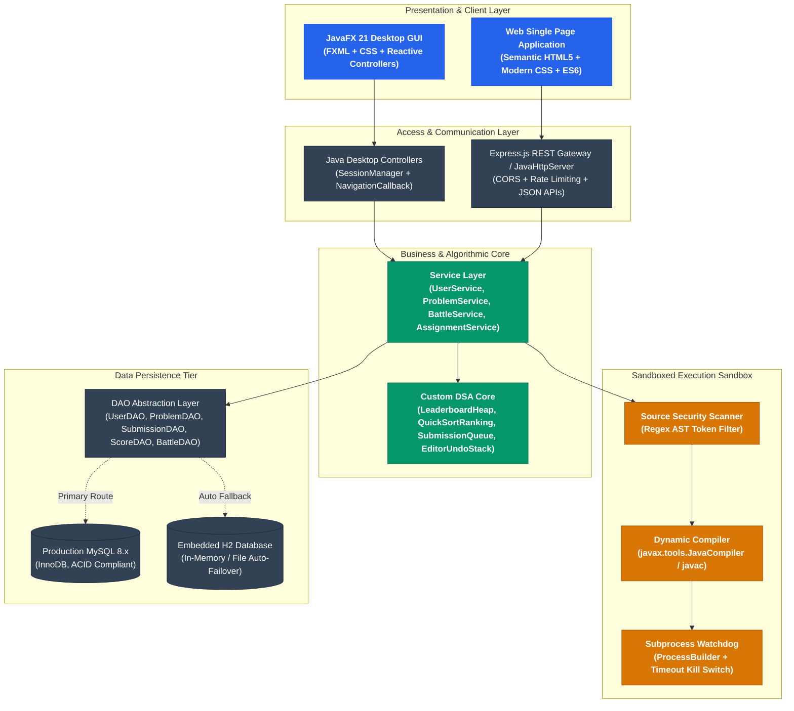
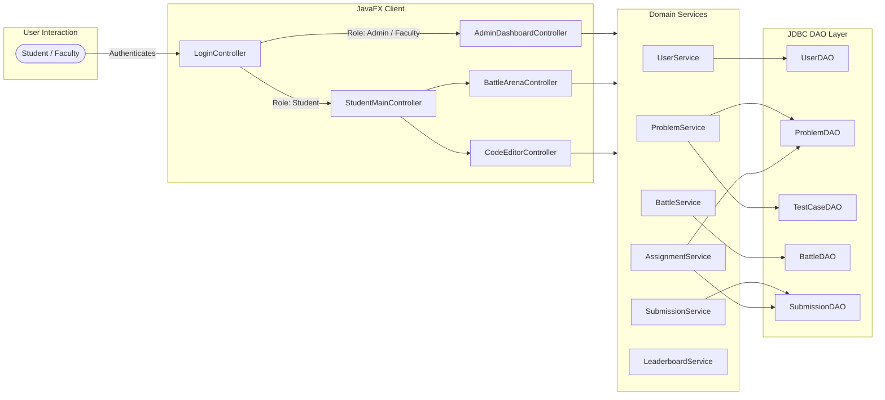
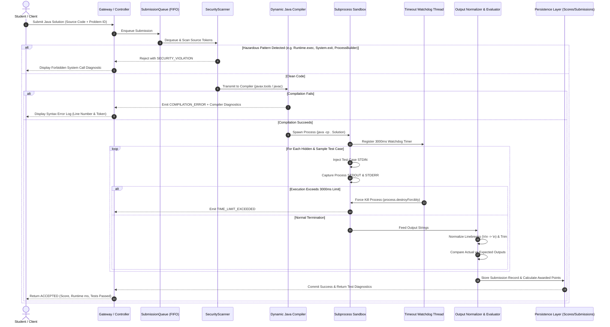
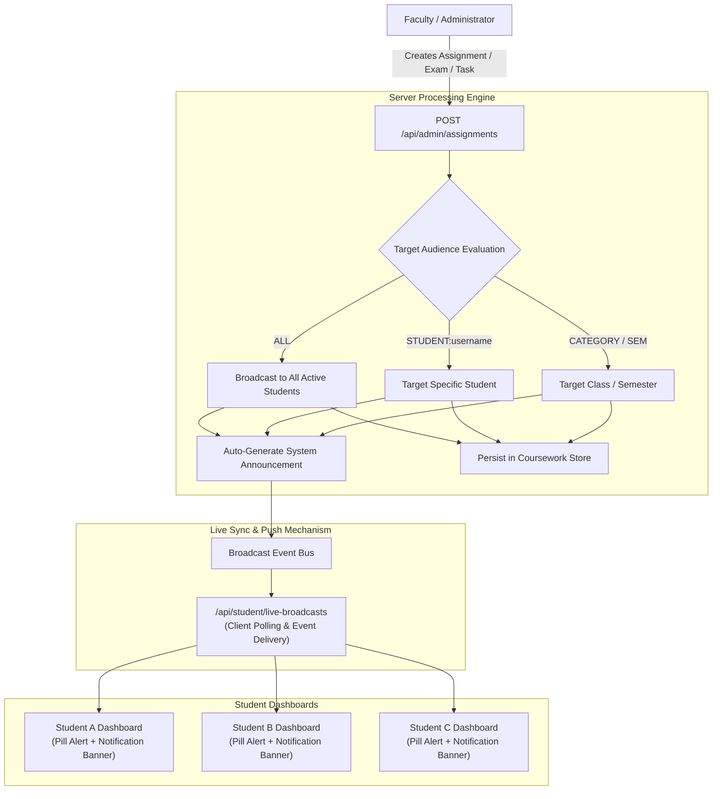
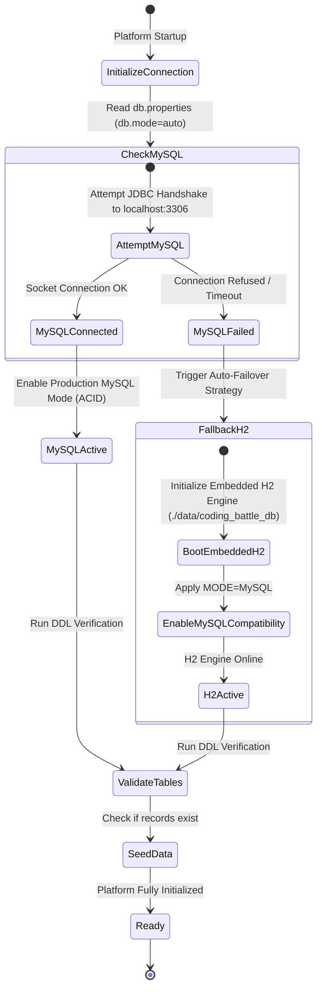
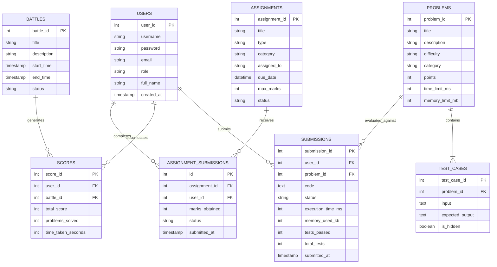

# 🏛️ Coding Battle Platform — System Architecture & Technical Blueprint

> **Course**: Object-Oriented Programming using Java (CSE203) — Java Mini Project  
> **Mandated Architecture**: JavaFX (Frontend) + Core Java (Backend & OOP/DSA) + JDBC (Database Connectivity) + MySQL (Storage)  
> **Primary Client**: JavaFX 21 Native Desktop Client (Hardware Accelerated FXML & CSS)  
> **Language**: Java 17+ (Core & Advanced Java)  
> **Database**: Dual-Engine (Production MySQL with zero-config Embedded H2 auto-failover)  

---

## 📑 Table of Contents
1. [Executive Architectural Overview](#1-executive-architectural-overview)
2. [Multi-Tier System Architecture](#2-multi-tier-system-architecture)
3. [Component Hierarchy & Data Flow](#3-component-hierarchy--data-flow)
4. [Sandboxed Java Code Execution Engine](#4-sandboxed-java-code-execution-engine)
5. [Real-Time Notification & Task Broadcast Engine](#5-real-time-notification--task-broadcast-engine)
6. [Resilient Dual-Mode Database Architecture](#6-resilient-dual-mode-database-architecture)
7. [Design Patterns & Structural Blueprint](#7-design-patterns--structural-blueprint)
8. [Thread Safety, Concurrency & Process Watchdogs](#8-thread-safety-concurrency--process-watchdogs)

---

## 1. Executive Architectural Overview

The **Coding Battle Platform** is engineered as a resilient, high-performance competitive programming ecosystem designed for higher-education computer science coursework, lab practical examinations, and timed coding competitions.

The platform provides a dual-client interface:
- **Native Desktop Client (JavaFX 21)**: Provides a high-fidelity desktop IDE experience with hardware acceleration, split-pane coding, and low-latency local execution.
- **Modern Web Client (HTML5 / ES6 / Express)**: Accessible across any modern browser, tablet, or workstation without requiring local compilation tools installed on student machines.

---

## 2. Multi-Tier System Architecture

The architecture is partitioned into five distinct, strictly decoupled tiers:

| Tier | Primary Responsibilities | Key Technologies |
| :--- | :--- | :--- |
| **1. Client Tier** | User interface rendering, syntax highlighting, Monaco-like editor behavior, undo/redo buffers, countdown timers. | JavaFX 21, FXML, CSS3, HTML5, Vanilla JavaScript (ES6+). |
| **2. Controller / Gateway Tier** | Session verification, route handling, role authorization (`STUDENT` vs `ADMIN`), input validation. | JavaFX Controllers, Express.js middleware, `SessionManager`. |
| **3. Business & DSA Tier** | Coursework logic, contest scoring calculations, Top-K leaderboard sorting, asynchronous submission queues. | Java 17 OOP, `LeaderboardHeap`, `QuickSortRanking`, `SubmissionQueue`. |
| **4. Sandboxed Execution Tier** | Dynamic code compilation, subprocess isolation, memory and runtime bounds enforcement, diff validation. | `javax.tools.JavaCompiler`, `ProcessBuilder`, Watchdog threads. |
| **5. Data Persistence Tier** | Storage of users, problems, test cases, submissions, scores, battles, assignments, and audit trails. | JDBC, MySQL 8.0, Embedded H2 Database, Connection Pool. |

---

## 3. Component Hierarchy & Data Flow

---

## 4. Sandboxed Java Code Execution Engine

Evaluating untrusted student-submitted source code requires strict process isolation, resource capping, and security screening to prevent system tampering, memory depletion, or denial-of-service (DoS) loops.

### Execution Sequence Workflow

### Security Guardrails
1. **Source Token Scanning**: Before compiling, code is parsed through strict regular expressions filtering system manipulation:
   - `java.lang.reflect.*`
   - `java.lang.Runtime`
   - `java.lang.ProcessBuilder`
   - `System.exit()`
   - Arbitrary file I/O outside sandboxed working directory.
2. **Subprocess Isolation**: Student code runs in a distinct OS process created by `ProcessBuilder`, preventing heap pollution of the main application.
3. **Hardware Watchdogs**: A dedicated background thread monitors execution duration. If an execution exceeds 3000ms (preventing `while(true)` freezes), the thread forcefully invokes `destroyForcibly()`.

---

## 5. Real-Time Notification & Task Broadcast Engine

The Faculty / Admin Command Portal allows instructors to broadcast assignments, laboratory practical exams, and urgent coding missions instantly to every connected student dashboard.

---

## 6. Resilient Dual-Mode Database Architecture

To guarantee **zero downtime and 100% presentation reliability** during lab evaluations or viva defense sessions, the platform features a self-healing dual-engine persistence layer.

### Relational Database Schema (ERD)

---

## 7. Design Patterns & Structural Blueprint

The platform strictly exemplifies established Software Engineering and Object-Oriented Design Patterns:

| Design Pattern | Implementation Location | Purpose & Architectural Justification |
| :--- | :--- | :--- |
| **Factory Pattern** | `CodeEvaluatorFactory` | Dynamically produces language-specific evaluators (Java, Python, C++) decoupled from the execution caller. |
| **Strategy Pattern** | `ScoreCalculator`, `DefaultScoreCalculator` | Encapsulates competitive scoring algorithms (e.g., speed decay, difficulty weightings, penalty deductions). |
| **Singleton Pattern** | `DatabaseConnection`, `SessionManager` | Guarantees a single shared connection pool and consistent user session state across multi-window views. |
| **Data Access Object (DAO)** | `UserDAO`, `ProblemDAO`, `SubmissionDAO`, etc. | Completely isolates raw SQL queries and relational persistence from the application's business layer. |
| **Model-View-Controller (MVC)** | JavaFX Controllers (`FXML` + Controllers + Models) | Strict decoupling of UI declarative state from domain logic and database interactions. |
| **Observer Pattern** | `NavigationCallback`, Live Notifications | Emits UI navigation transitions and real-time announcement updates across multiple listening views. |

---

## 8. Thread Safety, Concurrency & Process Watchdogs

1. **JavaFX Application Thread Safety**:
   - All background computation (compilation, database transactions, network I/O) executes on worker threads (`ExecutorService`).
   - UI updates are routed back to the main GUI thread strictly via `Platform.runLater()`, preventing `IllegalStateException: Not on FX application thread`.
2. **Submission Queue Concurrency**:
   - `SubmissionQueue` utilizes Java synchronization locks to safely ingest concurrent code submissions from multiple students without race conditions.
3. **Subprocess Watchdogs**:
   - Every execution subprocess is assigned an independent watchdog thread that performs a non-blocking `process.waitFor(3000, TimeUnit.MILLISECONDS)`. If timed out, `process.destroyForcibly()` ensures no orphaned threads or zombie processes consume server resources.

