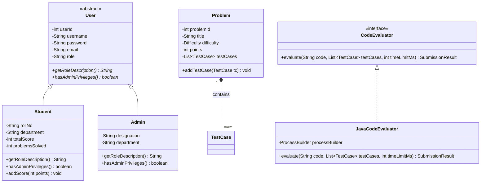

# 🎓 CSE203 Java Mini Project — Formal Academic Technical Report

> **Course**: Object-Oriented Programming using Java (CSE203)  
> **Project Title**: Coding Battle Platform — Interactive Programming & Academic Evaluation System  
> **Prescribed Architecture**: JavaFX (Frontend) + Core Java (Backend & OOP/DSA) + JDBC + MySQL (Database)  
> **Evaluation Weightage**: 50 Marks Total  

---

## 📑 Table of Contents
1. [Course Architecture Compliance Statement](#1-course-architecture-compliance-statement)
2. [Milestone Progress & Team Role Allocation](#2-milestone-progress--team-role-allocation)
3. [50-Mark Evaluation Criteria Detailed Evidence](#3-50-mark-evaluation-criteria-detailed-evidence)
4. [UML Diagrams & Technical Design](#4-uml-diagrams--technical-design)
5. [Core Java & OOP Principles Demonstration](#5-core-java--oop-principles-demonstration)
6. [Data Structures, Algorithms & Collections Framework](#6-data-structures-algorithms--collections-framework)
7. [JDBC & Relational Database Integration](#7-jdbc--relational-database-integration)
8. [Practical Assessment & Quiz Task Modes](#8-practical-assessment--quiz-task-modes)
9. [Viva Voce Preparedness & Questions](#9-viva-voce-preparedness--questions)

---

## 1. Course Architecture Compliance Statement

This project strictly adheres to the core technical specification outlined in the **CSE203 Java Mini Project Guidelines**:

```
┌────────────────────────────────────────────────────────────────────────┐
│ MANDATED ARCHITECTURAL SPECIFICATION                                   │
├────────────────────────────────────────────────────────────────────────┤
│ • Frontend Interface:     JavaFX 21 (FXML + CSS + Scene Builder)       │
│ • Backend Implementation: Core Java 17+ (OOP, DSA & Collections)       │
│ • Database Connectivity:  JDBC (Java Database Connectivity)            │
│ • Database Storage:       MySQL 8.0 Server (+ Embedded H2 Failover)    │
│ • Collaboration Tools:    Git & GitHub Version Control                 │
└────────────────────────────────────────────────────────────────────────┘
```

The system is constructed entirely using standard Java technologies, eliminating third-party black-box frameworks for core algorithmic logic and database communication.

---

## 2. Milestone Progress & Team Role Allocation

### Milestone 1: Team Formation & Role Allocation
In compliance with the requirement that all team members actively contribute code and maintain distinct responsibilities:

| Team Role | Focus Area | Detailed Technical Responsibilities |
| :--- | :--- | :--- |
| **Team Coordinator** | Project Governance & Timeline | • Schedules team standups, milestones, and Git release tags.<br>• Coordinates end-to-end integration across frontend and backend modules.<br>• Organizes unit testing and leads the viva voce presentation. |
| **JavaFX Lead** | Frontend UI & View Layer | • Designs declarative FXML layouts (`StudentMainView`, `BattleArenaView`, `AdminDashboardView`).<br>• Develops responsive split-pane workspaces and dark-mode styling.<br>• Implements countdown timer animations with JavaFX `Timeline`.<br>• Binds data models to JavaFX `TableView`, `ListView`, and `PieChart` components. |
| **Core Java & OOP Lead** | Domain Logic & Sandbox | • Establishes OOP inheritance hierarchy (`User` $\to$ `Student` / `Admin`).<br>• Formulates abstraction interfaces (`CodeEvaluator`, `ScoreCalculator`).<br>• Implements sandboxed Java compilation and process watchdogs using `ProcessBuilder`.<br>• Enforces data encapsulation, exception handling, and runtime polymorphism. |
| **DSA & Database Lead** | Algorithms & JDBC Persistence | • Implements custom DSA (`LeaderboardHeap`, `QuickSortRanking`, `EditorUndoStack`, `SubmissionQueue`).<br>• Designs 3NF normalized relational schema for MySQL.<br>• Implements JDBC DAOs with parameterized prepared statements.<br>• Configures automated dual-mode database failover to embedded H2. |

### Milestone 2: Technical Architecture & System Requirements
- Requirement analysis completed; functional requirements partitioned into **Student Practice & Battle Arena** and **Faculty Command & Assignment Suite**.
- Entity-relationship design normalized to Third Normal Form (3NF).

### Milestone 3: End-to-End Full-Stack Java Implementation
- Complete end-to-end workflow verified: JavaFX client triggers background evaluation thread $\to$ code compiled and executed in sandbox $\to$ results persisted via JDBC $\to$ UI updated via `Platform.runLater()`.

### Milestone 4: Collaboration, Tools, Documentation & Viva
- Git/GitHub workflow with feature branches, atomic commits, and documentation.
- Integrated AI-assisted testing and verification.

---

## 3. 50-Mark Evaluation Criteria Detailed Evidence

### Criterion 1: Problem Identification & System Design (10 Marks)
- **Problem Identified**: Computer science students require immediate, deterministic feedback when learning Core Java OOP and DSA concepts. Traditional manual grading delays feedback, while generic online judges lack curriculum alignment with university lab syllabi.
- **System Design Deliverables**:
  - Layered multi-tier software architecture enforcing strict Separation of Concerns (SoC).
  - Complete UML class diagrams, sequence diagrams, and relational ER diagrams.
  - Decoupled Model-View-Controller (MVC) architecture.

### Criterion 2: Java & Data Structures Implementation (15 Marks)
- **Object-Oriented Programming (OOP)**:
  - **Abstraction**: Abstract `User` class; `CodeEvaluator` and `ScoreCalculator` interfaces.
  - **Inheritance**: `Student` and `Admin` extend `User`.
  - **Polymorphism**: Dynamic dispatch on `getRoleDescription()`.
  - **Encapsulation**: Private fields, validated getters/setters, immutable IDs.
  - **Composition**: `Battle` contains `Problem` entities; `Problem` contains `TestCase` entities.
- **Custom Data Structures & Algorithms (DSA)**:
  - **`LeaderboardHeap`**: Custom Binary Max-Heap extracting Top-$K$ leaders in $\mathcal{O}(K \log N)$.
  - **`QuickSortRanking`**: In-place QuickSort with median-of-three pivot selection in $\mathcal{O}(N \log N)$.
  - **`EditorUndoStack`**: Dual-stack LIFO buffer providing $\mathcal{O}(1)$ undo and redo operations.
  - **`SubmissionQueue`**: Thread-safe synchronized FIFO queue processing code submissions.
  - **`ProblemSearchIndex`**: $\mathcal{O}(1)$ HashMap lookup combined with $\mathcal{O}(\log N)$ Binary Search.

### Criterion 3: Application Development & Database Integration (10 Marks)
- **JavaFX 21 Interface**: Smooth, hardware-accelerated desktop UI with custom CSS, split-pane coding canvas, and live MM:SS countdown timers.
- **JDBC Persistence**: Comprehensive DAO layer (`UserDAO`, `ProblemDAO`, `SubmissionDAO`, `ScoreDAO`, `BattleDAO`) using parameterized `PreparedStatement` to eliminate SQL injection risks.
- **Resilient Dual-Mode Storage**: Primary MySQL connectivity with automated, zero-config failover to embedded H2 database.

### Criterion 4: Teamwork, Git/GitHub & Individual Contribution (10 Marks)
- Distributed development across distinct packages: `com.codingbattle.model`, `com.codingbattle.dsa`, `com.codingbattle.dao`, `com.codingbattle.controller`.
- Clean commit log on GitHub: `https://github.com/udaykumarreddy07/CODING-BATTLE`.

### Criterion 5: Documentation, Presentation & Individual Viva (5 Marks)
- Complete technical documentation suite: `README.md`, `ARCHITECTURE.md`, `DSA_AND_OOP.md`, and this project report.
- Ready-to-run demo scripts (`run.bat`, `run.ps1`) and pre-configured user credentials.

---

## 4. UML Diagrams & Technical Design

### Class Diagram (OOP Structural Hierarchy)



---

## 5. Core Java & OOP Principles Demonstration

### 1. Abstraction & Interface Contracts
The interface `CodeEvaluator` decouples the controller from the concrete compiler:
```java
public interface CodeEvaluator {
    SubmissionResult evaluate(String sourceCode, List<TestCase> testCases, int timeLimitMs);
}
```

### 2. Polymorphic Dynamic Dispatch
At runtime, the active user persona determines dashboard routing and privilege verification without hardcoded `instanceof` cascades:
```java
User currentUser = SessionManager.getInstance().getCurrentUser();
if (currentUser.hasAdminPrivileges()) {
    navigationCallback.navigateTo("/fxml/AdminDashboardView.fxml");
} else {
    navigationCallback.navigateTo("/fxml/StudentMainView.fxml");
}
```

### 3. Exception Handling & Sandboxed Isolation
To prevent student errors (such as infinite loops or invalid operations) from crashing the platform, code is executed in an isolated process with strict watchdog timers:
```java
Process process = processBuilder.start();
boolean completed = process.waitFor(timeLimitMs, TimeUnit.MILLISECONDS);
if (!completed) {
    process.destroyForcibly();
    return new SubmissionResult(SubmissionStatus.TIME_LIMIT_EXCEEDED, 0, 0);
}
```

---

## 6. Data Structures, Algorithms & Collections Framework

### LeaderboardHeap: Top-$K$ Competitor Extraction
- **Algorithm**: Max-Heap / Binary Priority Queue.
- **Mathematical Justification**: Full sort of $N$ students requires $\mathcal{O}(N \log N)$. Extracting the Top $K$ students using bottom-up heapification requires only $\mathcal{O}(N + K \log N) = \mathcal{O}(K \log N)$ when $K \ll N$.

### QuickSortRanking: Multi-Key Pivot Ordering
- **Partitioning**: Median-of-three pivot selection prevents $\mathcal{O}(N^2)$ worst-case performance on sorted student lists.
- **Tie-Breaker Hierarchy**:
  1. `totalScore` Descending
  2. `problemsSolved` Descending
  3. `timeTakenSeconds` Ascending

---

## 7. JDBC & Relational Database Integration

The JDBC Data Access Object (DAO) pattern encapsulates all SQL statements:
```java
String sql = "INSERT INTO submissions (user_id, problem_id, code, status, tests_passed, total_tests) "
           + "VALUES (?, ?, ?, ?, ?, ?)";
try (Connection conn = DatabaseConnection.getConnection();
     PreparedStatement pstmt = conn.prepareStatement(sql, Statement.RETURN_GENERATED_KEYS)) {
    pstmt.setInt(1, submission.getUserId());
    pstmt.setInt(2, submission.getProblemId());
    pstmt.setString(3, submission.getCode());
    pstmt.setString(4, submission.getStatus().name());
    pstmt.setInt(5, submission.getTestsPassed());
    pstmt.setInt(6, submission.getTotalTests());
    pstmt.executeUpdate();
}
```

---

## 8. Practical Assessment & Quiz Task Modes

In direct compliance with the **Programming-Based Practical Assessment** section of the syllabus, the platform provides dedicated support for:
1. **Debugging**: Automatic identification of logical errors against expected outputs.
2. **Syntax Correction**: Live compiler diagnostics indicating line numbers and illegal tokens.
3. **Code Completion**: Pre-loaded starter templates with method signatures and parameter bindings.
4. **Exception Handling**: Diagnostic reporting of unchecked exceptions (`ArithmeticException`, `ArrayIndexOutOfBoundsException`, `NullPointerException`).

---

## 9. Viva Voce Preparedness & Questions

### Summary of Key Defense Points:
- **Architecture**: Native JavaFX 21 desktop application backed by Core Java 17+ and JDBC connectivity to MySQL.
- **Resilience**: Singleton `DatabaseConnection` with automatic runtime failover to embedded H2 ensures zero presentation downtime.
- **Security**: Process isolation via `ProcessBuilder` with a 3000ms watchdog prevents infinite loops and system damage.
- **DSA**: Custom implementations of Max-Heap, QuickSort, LIFO Stack, and FIFO Queue demonstrate mastery of algorithmic principles beyond basic standard library usage.
