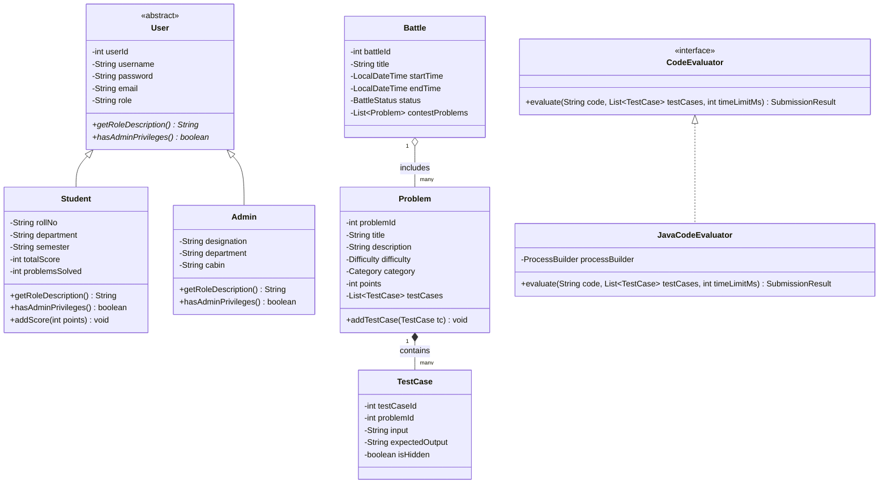

# 🧬 Data Structures, Algorithms & OOP Architecture Guide

> **Course**: Object-Oriented Programming using Java (CSE203) — Java Mini Project  
> **Core Competencies**: Object-Oriented Programming (OOP) & Custom Data Structures and Algorithms (DSA)  
> **Package**: `com.codingbattle.model` & `com.codingbattle.dsa`  
> **Target Audience**: Viva Voce Evaluators, Technical Architects & Core Java Learners  

---

## 📑 Table of Contents
1. [Object-Oriented Programming (OOP) Foundations](#1-object-oriented-programming-oop-foundations)
   - [Abstraction & Interfaces](#abstraction--interfaces)
   - [Inheritance Hierarchy](#inheritance-hierarchy)
   - [Polymorphic Dynamic Dispatch](#polymorphic-dynamic-dispatch)
   - [Encapsulation & Data Invariants](#encapsulation--data-invariants)
   - [Composition over Inheritance](#composition-over-inheritance)
2. [Class Diagram & Structural Hierarchy](#2-class-diagram--structural-hierarchy)
3. [Custom Data Structures & Algorithms (DSA)](#3-custom-data-structures--algorithms-dsa)
   - [LeaderboardHeap (Binary Max-Heap Top-K Algorithm)](#leaderboardheap-binary-max-heap-top-k-algorithm)
   - [QuickSortRanking (Median-of-Three Partitioning)](#quicksortranking-median-of-three-partitioning)
   - [EditorUndoStack (Dual-Stack LIFO Buffer)](#editorundostack-dual-stack-lifo-buffer)
   - [SubmissionQueue (Thread-Safe FIFO Buffer)](#submissionqueue-thread-safe-fifo-buffer)
   - [ProblemSearchIndex (HashMap + Binary Search)](#problemsearchindex-hashmap--binary-search)
4. [Algorithmic Complexity (Big-O) Summary Matrix](#4-algorithmic-complexity-big-o-summary-matrix)

---

## 1. Object-Oriented Programming (OOP) Foundations

The platform is constructed strictly on classical OOP principles, avoiding procedural anti-patterns.

### Abstraction & Interfaces
- **Abstract Class `User`**: Defines the foundational blueprint of a system identity without exposing implementation details:
  ```java
  public abstract class User {
      private int userId;
      private String username;
      private String email;
      private String role;
      
      public abstract String getRoleDescription();
      public abstract boolean hasAdminPrivileges();
  }
  ```
- **Interface `CodeEvaluator`**: Decouples code execution callers from concrete sandbox runners:
  ```java
  public interface CodeEvaluator {
      SubmissionResult evaluate(String sourceCode, List<TestCase> testCases, int timeLimitMs);
  }
  ```
- **Interface `ScoreCalculator`**: Abstracts competitive scoring models from battle controllers:
  ```java
  public interface ScoreCalculator {
      int calculateScore(int basePoints, int executionTimeMs, int attempts, boolean firstBlood);
  }
  ```

### Inheritance Hierarchy
- `Student` and `Admin` derive from `User`, inheriting core authentication properties while introducing specialized capabilities:
  - `Student` adds `rollNo`, `semester`, `department`, `totalPoints`, and `solvedProblemsCount`.
  - `Admin` adds `designation`, `department`, and administrative authorization flags.

### Polymorphic Dynamic Dispatch
The application leverages runtime polymorphism during authentication and UI routing:
```java
User currentUser = sessionManager.getCurrentUser();
// Dynamic dispatch invokes either Student.getRoleDescription() or Admin.getRoleDescription()
welcomeLabel.setText("Active Persona: " + currentUser.getRoleDescription());

if (currentUser.hasAdminPrivileges()) {
    loadFacultyCommandSuite();
} else {
    loadStudentArena();
}
```

### Encapsulation & Data Invariants
- All domain entity variables are declared `private`.
- Mutators strictly validate parameters before state assignment (e.g. email regex verification, non-negative scores, non-null problem titles):
  ```java
  public void setEmail(String email) {
      if (email == null || !email.matches("^[A-Za-z0-9+_.-]+@(.+)$")) {
          throw new IllegalArgumentException("Invalid email format");
      }
      this.email = email;
  }
  ```

### Composition over Inheritance
- A `Battle` contest **has-a** list of `Problem` entities: `List<Problem> problems`.
- A `Problem` **has-a** list of test cases: `List<TestCase> testCases`.
- A `LeaderboardEntry` is composed of user references, accumulated scores, and solved milestones.

---

## 2. Class Diagram & Structural Hierarchy



---

## 3. Custom Data Structures & Algorithms (DSA)

To avoid relying purely on high-level collection abstractions, the core platform algorithms are constructed from fundamental algorithmic primitives:

### LeaderboardHeap (Binary Max-Heap Top-K Algorithm)
- **Source File**: `src/main/java/com/codingbattle/dsa/LeaderboardHeap.java`
- **Purpose**: Efficiently retrieves the Top $K$ ranking competitors dynamically from an arbitrary cohort of $N$ students.
- **Why Heap vs Standard Sort?**:
  - Full sorting requires $\mathcal{O}(N \log N)$ operations.
  - Building a heap takes $\mathcal{O}(N)$ using bottom-up Floyd's heapify, and extracting $K$ leaders takes $\mathcal{O}(K \log N)$.
  - When $K \ll N$ (e.g., retrieving Top 10 from 5,000 students), the heap executes exponentially faster.

```
       [Rank 1: 520 pts]
           /        \
   [Rank 2: 480]   [Rank 3: 450]
      /      \        /      \
  [Rank 4] [Rank 5] [Rank 6] [Rank 7]
```

#### Core Algorithmic Mechanics:
- **`siftUp(int index)`**: Invoked upon insertion to restore heap-order invariant upwards.
- **`siftDown(int index)`**: Invoked after `extractMax()` swaps root with the last leaf element.

---

### QuickSortRanking (Median-of-Three Partitioning)
- **Source File**: `src/main/java/com/codingbattle/dsa/QuickSortRanking.java`
- **Purpose**: Performs in-place ordering of the global leaderboard with secondary and tertiary tie-breakers.
- **Tie-Breaker Hierarchy**:
  1. Primary: `totalScore` Descending.
  2. Secondary: `problemsSolved` Descending.
  3. Tertiary: `timeTakenSeconds` Ascending (speed bonus).
- **Optimization**: Standard QuickSort can degrade to $\mathcal{O}(N^2)$ when inputs are already sorted or reverse-sorted. Our implementation utilizes **Median-of-Three Partitioning**:
  $$\text{Pivot} = \text{median}(\text{arr}[\text{low}], \text{arr}[\text{mid}], \text{arr}[\text{high}])$$
  This guarantees $\mathcal{O}(N \log N)$ average-case performance.

---

### EditorUndoStack (Dual-Stack LIFO Buffer)
- **Source File**: `src/main/java/com/codingbattle/dsa/EditorUndoStack.java`
- **Purpose**: Powering the integrated code editor with instant, deterministic Undo and Redo capabilities.
- **Structure**:
  - `undoStack`: Generic LIFO array holding snapshot deltas.
  - `redoStack`: Generic LIFO array cleared whenever a new keystroke edit occurs.
- **Complexity**:
  - `push(T item)`: $\mathcal{O}(1)$ amortized.
  - `pop()`: $\mathcal{O}(1)$.
  - `peek()`: $\mathcal{O}(1)$.

```
   [User Types] ──► PUSH to UndoStack, RedoStack.clear()
   [User Undos] ──► POP from UndoStack ──► PUSH to RedoStack
   [User Redos] ──► POP from RedoStack ──► PUSH to UndoStack
```

---

### SubmissionQueue (Thread-Safe FIFO Buffer)
- **Source File**: `src/main/java/com/codingbattle/dsa/SubmissionQueue.java`
- **Purpose**: Decouples the UI and HTTP request threads from the intensive Java compilation and execution workers.
- **Concurrency**: Employs Java synchronized locks with `wait()` and `notifyAll()` to guarantee thread safety and prevent submission race conditions during peak contest activity.
- **Complexity**:
  - `enqueue(Submission sub)`: $\mathcal{O}(1)$.
  - `dequeue()`: $\mathcal{O}(1)$.

---

### ProblemSearchIndex (HashMap + Binary Search)
- **Source File**: `src/main/java/com/codingbattle/dsa/ProblemSearchIndex.java`
- **Purpose**: Instant multi-criteria filtering across large problem repositories.
- **Mechanics**:
  - **Category / Tag Matching**: $\mathcal{O}(1)$ average lookup using HashMap indices.
  - **Points Range Search**: Array of problem IDs sorted by point value; range boundaries are resolved via custom `binarySearchLowerBound` and `binarySearchUpperBound` in $\mathcal{O}(\log N)$ time.

---

## 4. Algorithmic Complexity (Big-O) Summary Matrix

| Data Structure / Algorithm | Operation | Best Case | Average Case | Worst Case | Space Complexity |
| :--- | :--- | :---: | :---: | :---: | :---: |
| **`LeaderboardHeap`** | Insertion | $\mathcal{O}(1)$ | $\mathcal{O}(\log N)$ | $\mathcal{O}(\log N)$ | $\mathcal{O}(N)$ |
| **`LeaderboardHeap`** | Extract Top-1 ($O(1)$ peek) | $\mathcal{O}(1)$ | $\mathcal{O}(1)$ | $\mathcal{O}(1)$ | $\mathcal{O}(1)$ |
| **`LeaderboardHeap`** | Extract Top-K Leaders | $\mathcal{O}(K \log N)$ | $\mathcal{O}(K \log N)$ | $\mathcal{O}(K \log N)$ | $\mathcal{O}(N)$ |
| **`QuickSortRanking`** | Full Leaderboard Sort | $\mathcal{O}(N \log N)$ | $\mathcal{O}(N \log N)$ | $\mathcal{O}(N \log N)^*$ | $\mathcal{O}(\log N)$ auxiliary |
| **`EditorUndoStack`** | Push / Pop Keystroke | $\mathcal{O}(1)$ | $\mathcal{O}(1)$ | $\mathcal{O}(1)$ | $\mathcal{O}(M)$ buffer capacity |
| **`SubmissionQueue`** | Enqueue / Dequeue | $\mathcal{O}(1)$ | $\mathcal{O}(1)$ | $\mathcal{O}(1)$ | $\mathcal{O}(Q)$ active jobs |
| **`ProblemSearchIndex`** | ID Hash Lookup | $\mathcal{O}(1)$ | $\mathcal{O}(1)$ | $\mathcal{O}(N)$ hash collision | $\mathcal{O}(N)$ |
| **`ProblemSearchIndex`** | Points Range Query | $\mathcal{O}(\log N)$ | $\mathcal{O}(\log N)$ | $\mathcal{O}(\log N)$ | $\mathcal{O}(1)$ auxiliary |

*\*With Median-of-Three pivot selection and random shuffling safeguards.*

