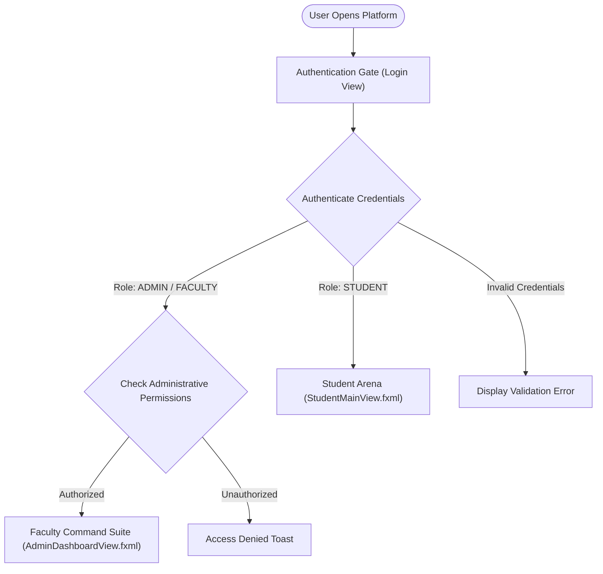

# 🖥️ Faculty & Student Portals — Functional & User Guide

> **Platform**: JavaFX 21 Desktop Client & Core Java Backend  
> **Key Personas**: Academic Faculty / Administrators & Computer Science Students  
> **Primary Interfaces**: `StudentMainView.fxml` (Student Arena) & `AdminDashboardView.fxml` (Faculty Command Suite)  

---

## 📑 Table of Contents
1. [Secure Authentication Gate & Role Routing](#1-secure-authentication-gate--role-routing)
2. [Faculty / Admin Command Suite](#2-faculty--admin-command-suite)
   - [Unified Administration Interface](#unified-administration-interface)
   - [Add Assignment & Task Dispatch Suite](#add-assignment--task-dispatch-suite)
   - [Real-Time Student Notification Broadcast Engine](#real-time-student-notification-broadcast-engine)
   - [Submission Audit & Gradebook Controls](#submission-audit--gradebook-controls)
   - [Curriculum & Test Case Management](#curriculum--test-case-management)
3. [Student Arena & Competition Hub](#3-student-arena--competition-hub)
   - [Personal Dashboard & Coursework Feed](#personal-dashboard--coursework-feed)
   - [Interactive Split-Pane Code Editor](#interactive-split-pane-code-editor)
   - [Real-Time Test Case Diagnostic Console](#real-time-test-case-diagnostic-console)
   - [Live Timed Battle Arena](#live-timed-battle-arena)
   - [Performance Analytics & Gamification](#performance-analytics--gamification)

---

## 1. Secure Authentication Gate & Role Routing

When opening the platform, users land at the dedicated **Authentication Gate**. The application enforces role-based redirection to ensure appropriate access privileges:



### Quick-Test Access Credentials
| Role | Username | Password | Default Routing |
| :--- | :--- | :--- | :--- |
| **Faculty / Admin** | `admin` | `admin123` | Navigates to `AdminDashboardView.fxml` with full administrative privileges |
| **Student** | `rahul` | `student123` | Navigates to `StudentMainView.fxml` (Rank #1, 610 pts, active streak) |
| **Student** | `ananya` | `student123` | Navigates to `StudentMainView.fxml` (Rank #2, active student) |
| **Student** | `kiran` | `student123` | Navigates to `StudentMainView.fxml` (Rank #3, active student) |

---

## 2. Faculty / Admin Command Suite

The **Faculty Command Suite** is consolidated into a single administrative portal (`/admin.html`), eliminating redundant split interfaces and providing direct operational control over the academic coding curriculum.

### Add Assignment & Task Dispatch Suite
Instructors can dispatch assignments, lab examinations, or debug missions directly to students:

```
┌────────────────────────────────────────────────────────────────────────┐
│ 📝 CREATE & BROADCAST ASSIGNMENT / EXAM                                │
├────────────────────────────────────────────────────────────────────────┤
│ Title:       [ Midterm Lab Exam: Object-Oriented Programming        ] │
│ Type:        [ (•) EXAM    ( ) ASSIGNMENT    ( ) TASK    ( ) DEBUG   ] │
│ Target:      [ (•) ALL Students   ( ) Specific Student   ( ) Section ] │
│ Problems:    [ [✓] Problem #1: Two Sum                               ] │
│              [ [✓] Problem #5: Maximum Subarray                      ] │
│ Due Date:    [ 2026-11-05 23:59 IST ]   Duration: [ 90 mins ]          │
│ Max Marks:   [ 50 pts ]                 Priority: [ [!] URGENT       ] │
│ Instructions:[ Implement clean OOP encapsulation. No external libs.  ] │
├────────────────────────────────────────────────────────────────────────┤
│ [ Cancel ]                                [ 🚀 DISPATCH & BROADCAST ]  │
└────────────────────────────────────────────────────────────────────────┘
```

#### What Happens Upon Dispatch?
1. **Validation**: Server verifies required parameters (title, problem list, valid deadline).
2. **Persistence**: The assignment is saved to the coursework datastore.
3. **Instant System Announcement**: An automated urgent notification is pushed to the system announcement feed.
4. **Live Student Dashboard Sync**: When students view their portal, a live notification banner alerts them of the new task, and their Coursework panel reflects the pending status with a direct link to solve the assigned problems.

### Submission Audit & Gradebook Controls
Instructors have real-time visibility into student work:
- **Automatic Grading**: The system automatically computes student marks based on test cases passed and execution speed.
- **Manual Grade Override**: Faculty can adjust marks and provide personalized feedback notes (e.g., *"Excellent optimization using dual pointers"*).
- **Deadline Extension**: One-click deadline extensions for individual students or the entire cohort.
- **Urgent Reminder**: One-click reminder button that pushes a high-priority alert to students who have not yet submitted.

---

## 3. Student Arena & Competition Hub

The **Student Arena** (`StudentMainView.fxml`) is structured for immersive coding and algorithmic practice:

### Interactive Split-Pane Code Editor
- **Syntax Highlighting**: Modern dark IDE theme with clean code readability.
- **Starter Code Templates**: Automatically populates standard class and method signatures for each chosen problem.
- **Custom Undo / Redo Buffers**: Powered by the custom `EditorUndoStack` for instant keystroke state restoration.
- **Reset Code**: Quick restoration of initial problem template.

### Real-Time Test Case Diagnostic Console
When students click **Run Code** or **Submit Solution**:
1. Output tabs display:
   - **Sample Test Cases**: Inputs, Expected Outputs, Actual Student Outputs, and Match indicators (✓ or ✗).
   - **Compiler Diagnostics**: Detailed line-number and syntax error explanations when code fails compilation.
   - **Execution Metrics**: Exact runtime in milliseconds and memory consumption in KB.
   - **System Standard Output / Console Log**: Captures standard `System.out.println` output for interactive debugging.

```
┌────────────────────────────────────────────────────────────────────────┐
│ TEST CASE RESULTS: 5 / 5 PASSED (ACCEPTED)                             │
├────────────────────────────────────────────────────────────────────────┤
│ [✓] Test Case 1: Input: [2, 7, 11, 15], 9 ──► Output: [0, 1] (Passed)  │
│ [✓] Test Case 2: Input: [3, 2, 4], 6       ──► Output: [1, 2] (Passed)  │
│ [✓] Test Case 3: Input: [3, 3], 6          ──► Output: [0, 1] (Passed)  │
│ [✓] Test Case 4 (Hidden):                  ──► Passed                  │
│ [✓] Test Case 5 (Hidden):                  ──► Passed                  │
├────────────────────────────────────────────────────────────────────────┤
│ Runtime: 48 ms | Memory: 18.2 MB | Points Awarded: +100 pts             │
└────────────────────────────────────────────────────────────────────────┘
```

### Live Timed Battle Arena
- **Synchronized Countdown Timer**: Visual MM:SS countdown timer synchronized with contest duration.
- **Problem Ribbon**: Allows seamless switching between contest problems with real-time solve indicators (✓).
- **Live Contest Scoreboard**: Ranked standings updated dynamically as competitors submit solutions.

### Performance Analytics & Gamification
- **Category Progress Bars**: Real-time mastery percentages across Arrays, Strings, Dynamic Programming, and OOP.
- **Streak Tracker**: Consecutive coding days indicator to encourage continuous lab practice.
- **Achievement Badges**: Visual milestone badges (`Array Master`, `Speed Demon`, `First Blood`, `Week Long Streak`).

